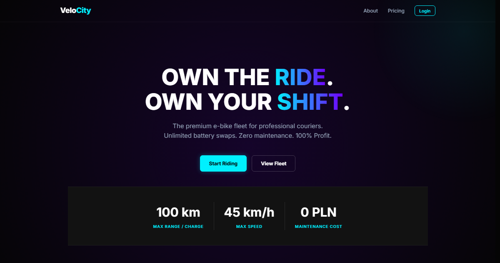
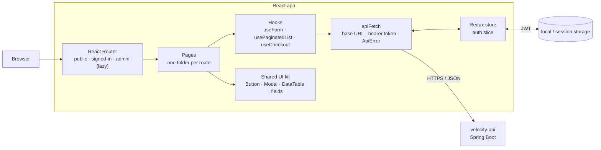

# VeloCity Client

[](https://github.com/jakub-jurkian/velocity-client/actions/workflows/ci.yml)

*The React & TypeScript frontend for an e-bike rental platform.*

| | |
|---|---|
| **Live app** | [www.velocityfleet.dev](https://www.velocityfleet.dev) |
| **Backend repo** | [jakub-jurkian/velocity-api](https://github.com/jakub-jurkian/velocity-api) |
| **Guided demo** | [velocity-api/DEMO.md](https://github.com/jakub-jurkian/velocity-api/blob/main/DEMO.md) |



> The live demo uses publicly listed demo accounts, including an admin one. Please do not register
> with real personal data.

## Overview

The single-page app manages courier e-bike rentals by the day. Because the backend owns every rule that matters - prices, availability, and double-booking - the client's main job is to present those rules honestly: show the exact price the server quoted, explain *why* an action was refused, and recover cleanly when two users race for the same bike.

**For Riders**
- **Session & Profile:** Register, log in (with "Remember me" storage), and edit profile details.
- **Booking Flow:** Pick dates (3-21 days), choose from bikes actually free in that city, and confirm against a server-quoted price that includes duration discounts.
- **Ride History:** Browse paginated history, export it as CSV, and cancel upcoming bookings. If staff cancelled a ride, the card explains why.

**For Admins**
- **Dashboard:** Track total revenue, live fleet utilisation, monthly trends, and model popularity via charts.
- **Fleet Management:** Filter bikes and change their status. If taking a bike offline conflicts with live bookings, the server rejects it first, and the admin sees exactly whose rides are affected before confirming the override.
- **User Management:** Edit details, change roles, and block or unblock accounts.

## Tech Stack

| Technology | Why it's here |
|---|---|
| **React 19 & TypeScript 5.9** | Typed components and API contracts; type errors fail the build. |
| **Vite 7** | Fast dev server and a production build with route-level code splitting. |
| **Redux Toolkit** | Holds the auth session app-wide, so a single 401 can end it everywhere at once. |
| **React Router 7** | Public, signed-in and admin routes; the private areas are lazy-loaded chunks. |
| **SCSS Modules** | Scoped styles on one set of theme tokens and mixins. |
| **Recharts** | Admin revenue and popularity charts - loaded only in the admin chunk. |
| **Framer Motion (`LazyMotion`)** | Page transitions without shipping the full animation library up front. |
| **date-fns** | Date maths for the booking wizard (3-21 day rentals, starting tomorrow). |
| **ESLint + GitHub Actions** | Lint, type-check and production build on every push and PR. |
| **Vercel** | Hosting, with a Content Security Policy and long-lived caching set in `vercel.json`. |

## Architecture



**The layers**

- **Pages** - one folder per route; compose the UI kit and hooks, no direct `fetch` calls.
- **Hooks** - reusable behaviour: form state and validation, paginated lists, the checkout flow, logout.
- **`apiFetch`** - the only way to call the backend: adds the base URL and token, parses JSON, and turns
  `application/problem+json` errors into a typed `ApiError`.
- **Store** - the auth session; everything else is server state fetched per page.

```
src/
  api/          apiFetch, ApiError, paginated fetch helpers
  components/   ui/ (shared kit), MainLayout/, AuthLayout/, common/
  data/         cities and hubs, fleet catalogue, rental limits
  hooks/        useForm, usePaginatedList, useCheckout, useLogout
  pages/        one folder per route, admin pages under Admin/
  store/        Redux store and the auth slice
  styles/       theme tokens, mixins and globals
  types/        API response types
  utils/        formatting, validation and small helpers
```

## Engineering Decisions

- **The server owns money and availability.** The availability search returns a server-priced quote and
  the client only renders it, so the total shown can never drift from the one stored. When two riders race
  for the same bike, the loser gets a `409` and the wizard re-runs the search so they pick from what is
  still free.
- **Two kinds of `409`, told apart.** A bike status change carries its `version`. The API answers `409`
  for a stale version *or* for live bookings in the way; the client distinguishes them by the response
  body - a stale version refreshes the list, live bookings open a second confirmation listing each one.
- **One API client.** [`apiFetch`](src/api/client.ts) maps RFC 9457 problem responses to an `ApiError`
  whose per-field messages land on the matching form inputs. A 401 on the stored session ends it once,
  app-wide, instead of every page failing on its own.
- **Lists that stay correct.** [`usePaginatedList`](src/hooks/usePaginatedList.ts) keeps the page's `meta`
  and aborts the previous request whenever the page or filter changes, so a fast double click can never
  show an older page.
- **A small shared UI kit.** [`src/components/ui`](src/components/ui) holds the Button (with an in-flight
  spinner), Modal and ConfirmDialog, form fields, and a DataTable that becomes cards on phones.
  Consolidating the pages onto it cut the SCSS by 40%.
- **Loading only what a visitor needs.** Signed-in pages and the admin area are separate chunks, Framer
  Motion runs through `LazyMotion`, and the Inter font is self-hosted. Initial JavaScript fell from
  472 kB to 382 kB (155 kB to 129 kB gzipped) and initial CSS from 51 kB to 25 kB.
- **Accessible by default.** Dialogs trap and restore focus, every page has a skip link, field errors are
  announced through `aria-describedby`, and animations respect reduced motion.
- **A build that refuses to lie.** `npm run build` fails if `VITE_API_URL` is unset - otherwise Vite would
  inline `undefined` into every API URL and the site would fail in confusing ways.

## Trade-offs and Known Limitations

- **No automated tests yet.** CI runs lint, the type-check and a production build, but there are no unit
  or end-to-end tests. Next step: Vitest + React Testing Library for the hooks and booking wizard, and a
  Playwright smoke test of the booking flow against the demo API.
- **The JWT lives in web storage.** "Remember me" uses `localStorage`, otherwise `sessionStorage`. Any
  successful XSS could read the token; the Content Security Policy is the mitigation. An `HttpOnly`
  cookie would remove that risk but needs CSRF protection and backend changes.
- **No token refresh.** The backend issues 24-hour tokens with no refresh tokens, so an expired session
  sends the user back to login.
- **Server state is fetched per page.** There is no cache layer (such as RTK Query), so returning to a
  page refetches it - simple and always fresh, at the cost of extra requests.

## Running Locally

Requires Node.js 22.12+ and a running [velocity-api](https://github.com/jakub-jurkian/velocity-api).

```bash
npm install
cp .env.example .env   # VITE_API_URL, defaults to http://localhost:8080
npm run dev            # http://localhost:5173
npm run lint           # ESLint
npm run build          # type-check + production build into dist/
```

## Architecture Decision Records

Decisions that span both apps - double-booking prevention and the rich domain model - are recorded in the
backend repo: [velocity-api ADRs](https://github.com/jakub-jurkian/velocity-api/tree/main/docs/adrs).
